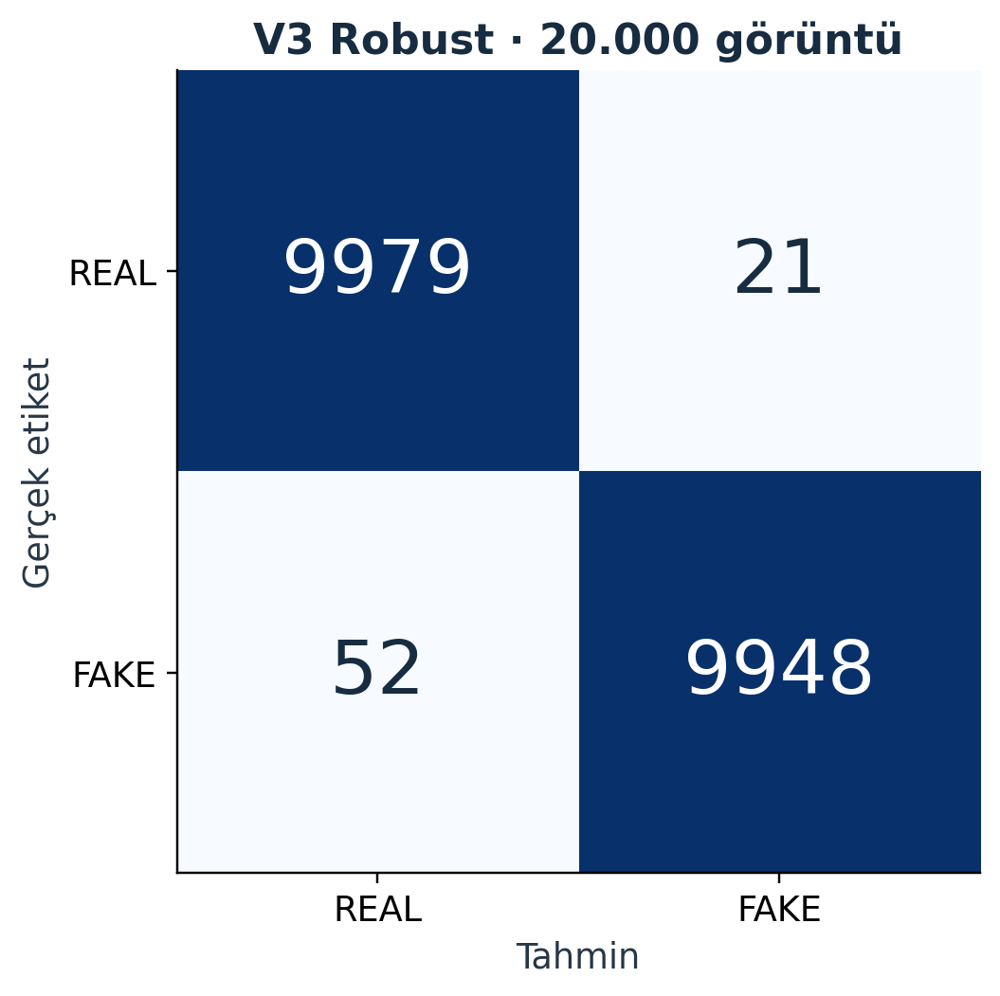
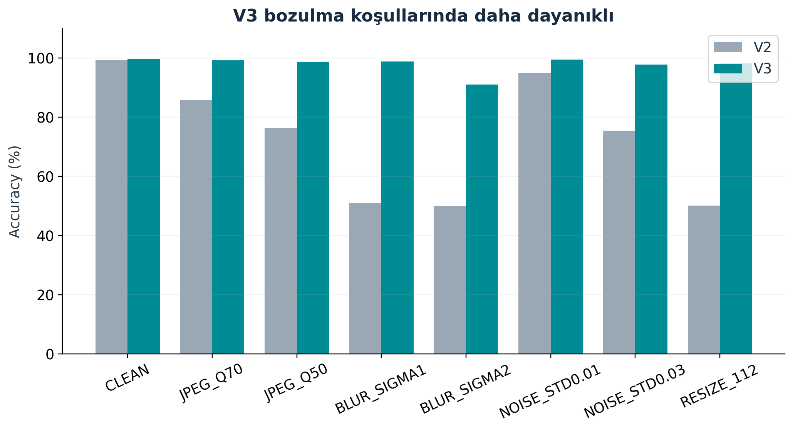
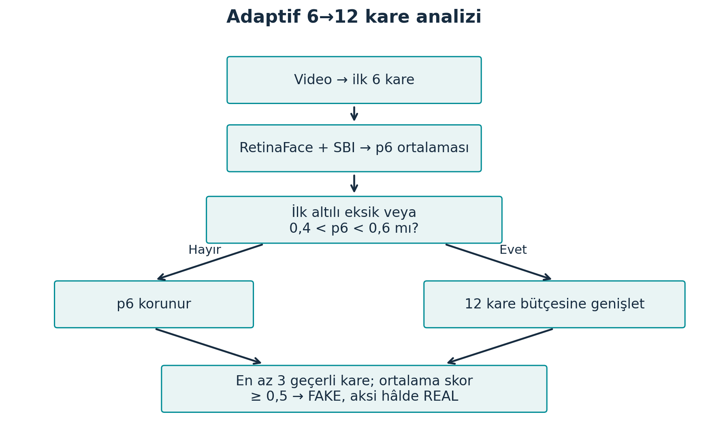
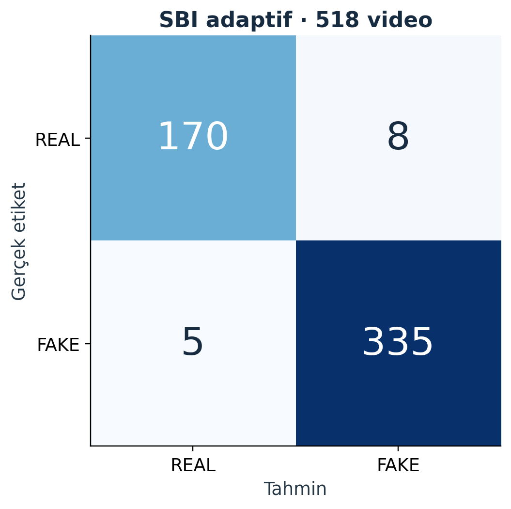
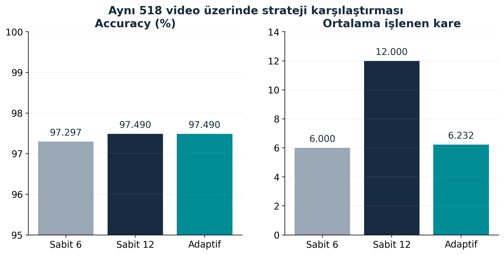
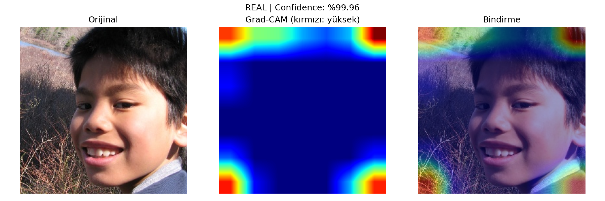
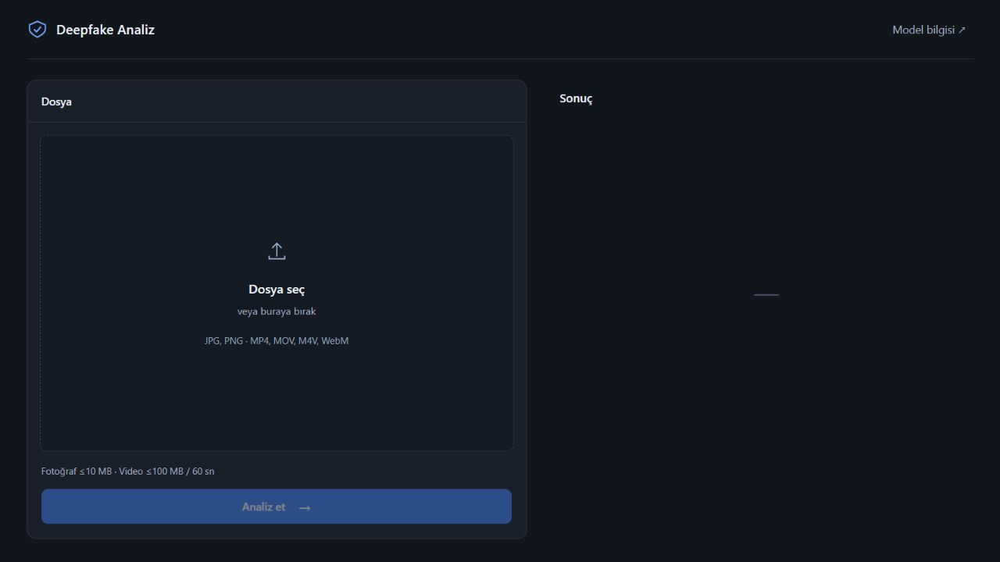
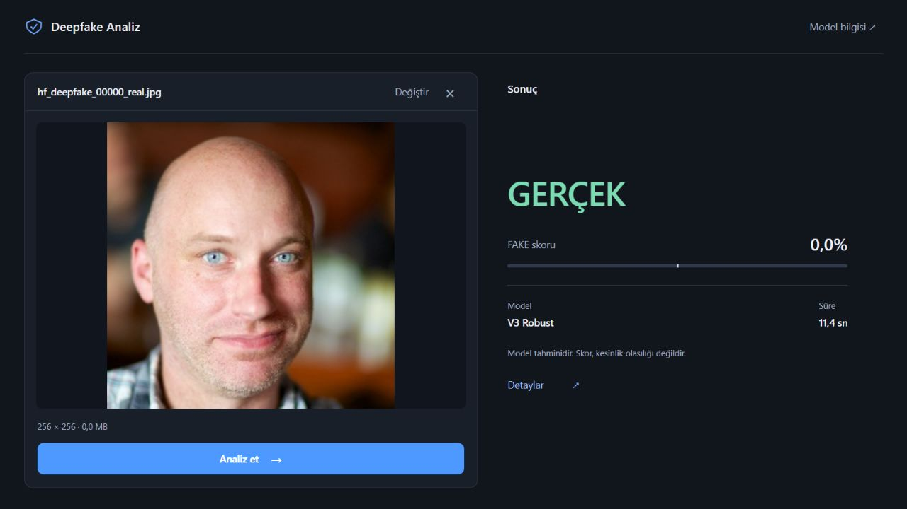
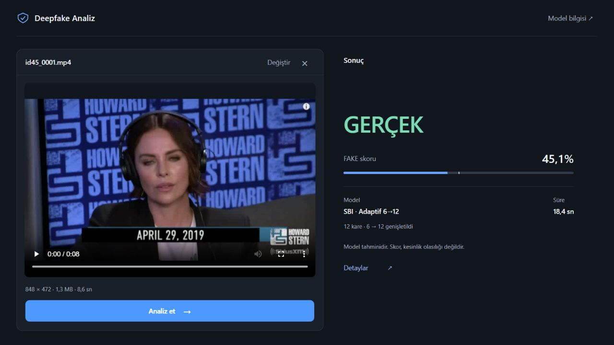
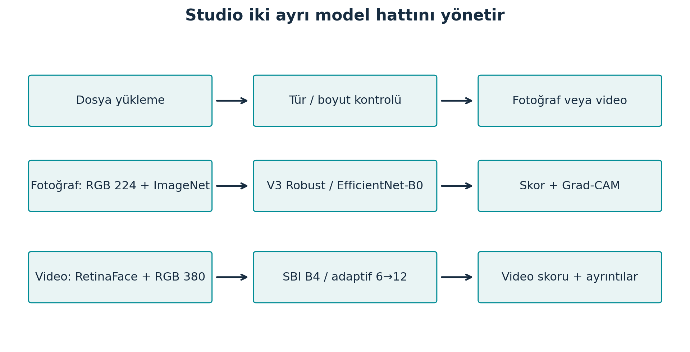

# Derin Öğrenme Tabanlı Deepfake Görüntü ve Video Tespiti

Derin Öğrenme Dersi Final Proje Raporu

Üniversite: ______________________________
Fakülte / Bölüm: __________________________
Öğrenci adı ve numarası: ___________________
Proje ekibi: ______________________________
Ders sorumlusu / Danışman: _________________

22 Ekim 2026

Final fotoğraf modeli: EfficientNet-B0 V3 Robust
Final video modeli: SBI EfficientNet-B4, epoch 6
Video örnekleme: Adaptif 6→12 kare

Yerel, ticari olmayan akademik çalışma

# Özet

Bu projede fotoğraf ve videolardaki deepfake içeriğini değerlendiren iki ayrı derin öğrenme hattı ve Windows üzerinde çalışan bir masaüstü arayüzü geliştirilmiştir. Fotoğraf hattında EfficientNet-B0 tabanlı V3 Robust modeli, video hattında Self-Blended Images (SBI) yaklaşımının EfficientNet-B4 modeli kullanılmıştır. Ortak arayüz dosya türünü tanır; ancak iki modelin skorlarını tek bir birleşik karara dönüştürmez.

V3, 140K Real and Fake Faces veri kümesinin 20.000 görüntülük tarihsel testinde %99,635 accuracy ve 0,99992647 ROC-AUC elde etmiştir. JPEG, bulanıklık, gürültü ve yeniden boyutlandırma kayıtları, önceki V2 modeline göre daha yüksek dayanıklılık göstermektedir. Video hattı, Celeb-DF v2 üzerinde yapılan fine-tuning sonrasında seçilen epoch-6 ağırlığını kullanır. Dosya ve taşıyıcı aile düzeyinde ayrılmış 518 videoluk VIDEO-HOLDOUT kaydında adaptif yöntem %97,4903 accuracy ve 0,997555 ROC-AUC sağlamıştır.

Adaptif yöntem önce altı kareyi inceler; skor belirsiz olduğunda veya ilk altılı eksik kaldığında on iki kare bütçesine genişler. Ortalama 6,2317 kare kullanılması sabit on ikiye göre %48,07 daha az işlenen kare anlamına gelir. Bu oran uçtan uca gecikme azalması olarak yorumlanamaz. Grad-CAM, fotoğraf kararını etkileyen bölgeleri yaklaşık olarak görselleştirir.

Başarı sonuçları kendi veri dağılımlarıyla sınırlıdır. Tam kişi bağımsızlığı kanıtlanmamış; küçük harici face-swap denemesinde iki fotoğraf araştırma dedektörü sekiz sahte örneğin tamamını kaçırmıştır. V4, V4.1 ve V5 pilotları kabul koşullarını geçmediğinden final uygulamaya alınmamıştır. Çalışmanın sonucu evrensel doğrulama aracı değil, sınırları belgelenmiş bir akademik prototiptir.

Anahtar kelimeler: deepfake, EfficientNet, Self-Blended Images, RetinaFace, Grad-CAM, adaptif kare örnekleme.

Rapor akışı: Problem ve literatür; veri ve yöntem; fotoğraf sonuçları; video ve adaptif analiz; Studio ve açıklanabilirlik; sınırlamalar ve sonuç.

# 1 Giriş ve ilgili çalışmalar

Yüz üretimi ile yüz değiştirme aynı görsel problemi oluşturmaz. GAN tabanlı bir üretici bütünüyle sentetik bir yüz görüntüsü oluşturabilirken face-swap gerçek bir çekimde yalnız belirli yüz bölgelerini değiştirebilir. Sıkıştırma, ölçekleme ve platform üzerinden yeniden paylaşım, dedektörün dayandığı izleri değiştirebilir. Bu nedenle tek bir test accuracy değeri bütün manipülasyon türlerinin kapsandığını göstermez.

Projenin amacı, sınırlı GPU kaynaklarıyla çalışabilecek fotoğraf ve video analizini kullanıcıya anlaşılır biçimde sunmaktır. Fotoğraf için sentetik yüz ayrımı, video için yüz manipülasyonu değerlendirmesi ayrı tutulmuştur. Projenin katkısı yeni bir temel mimari iddiası taşımamaktadır; mevcut ağların veri hazırlama, fine-tuning, değerlendirme, adaptif örnekleme ve güvenli yerel uygulama bileşenlerinde bir araya getirilmesidir.

EfficientNet, ağ derinliği, genişliği ve girdi çözünürlüğünü birlikte ölçeklendiren bir CNN ailesidir [1]. B0 ve B4 bu ailenin farklı kapasite noktalarıdır. Burada daha büyük mimarinin her görevde daha iyi olduğu varsayılmamış; model ve ön işlem sözleşmesi göreve göre korunmuştur. SBI, bir gerçek görüntünün farklı dönüşümlerinden üretilen karışım örnekleriyle manipülasyon izlerini öğrenmeyi hedefleyen önceden geliştirilmiş bir yöntemdir [2]. Bu yöntemin makaledeki başka veri kümelerine ilişkin sonuçları projemizin ölçümü olarak aktarılmamıştır.

Celeb-DF, yüksek kaliteli yüz değiştirme videolarını içeren bir değerlendirme kaynağıdır [3]. RetinaFace yüz konumlandırma için [4], Grad-CAM ise hedef sınıfın evrişimsel özelliklerle ilişkisini görselleştirmek için kullanılır [5]. Bir yüzün doğru algılanması, sınıflandırmanın doğru olduğunu; bir ısı haritasının yüz bölgesinde yoğunlaşması da gerçek manipülasyonun yerelleştirildiğini tek başına kanıtlamaz.

Bu raporda REAL=0 ve FAKE=1 eşlemesi korunmuştur. Karar eşiği 0,5 olarak sabittir. FAKE skoru, modelin karar değişkenidir; gerçek dünyada bir dosyanın sahte olma olasılığının kalibre edilmiş tahmini değildir.

### Tablo 1 Fotoğraf modellerinin tarihsel özeti

|Model|Test n|Accuracy %|FAKE F1 %|ROC-AUC|
|---|---|---|---|---|
|V1|1934|95,450|95,712|0.991857|
|V2|20000|99,410|99,409|0.998254|
|V3|20000|99,635|99,634|0.999926|

Not: V1 farklı veri/split kullanır; tek ortak benchmark sıralaması yapılamaz.

Kaynak: `outputs/metrics/final_test_metrics.json`; `outputs/metrics/final_test_metrics_v2.json`; `outputs/metrics/final_test_metrics_v3.json`

# 2 Veri kaynakları ve hazırlama

### Tablo 2 Veri kaynakları ve sınıf dağılımları

|Kaynak / birim|REAL|FAKE|Toplam|
|---|---|---|---|
|V1 görüntü|5890|7000|12890|
|140K eğitim / görüntü|50000|50000|100000|
|140K validation / görüntü|10000|10000|20000|
|140K test / görüntü|10000|10000|20000|
|Celeb-DF v2 / video|890|5639|6529|
|Harici HF / fotoğraf|8|8|16|

Not: V1 ayrı veri kaynağıdır. Harici fotoğraflar yalnız hata analizidir. Sağlayıcı etiketleri bağımsız üretim kanıtı değildir.

Kaynak: `outputs/metrics/dataset_audit.json`; `outputs/metrics/final_test_metrics_v3.json`; `docs/VIDEO_IDENTITY_SPLIT_V1.md`; `outputs/real_photo_research_v1/external_hf_v1/comparison.json`

140K kaynağı, 100.000 eğitim, 20.000 validation ve 20.000 test görüntüsü içerir; her ayrım REAL ve FAKE açısından dengelidir. Sağlayıcı açıklaması gerçek yüzleri FFHQ/Flickr, sentetik yüzleri StyleGAN kaynak zinciriyle ilişkilendirir [6]. Dosya düzeyinde kaynak ve kimlik eşleşmelerinin tamamı doğrulanmış değildir. Bilinen dosya ortaklığının kontrol edilmesi, bütün kişilerin veya üretici kaynaklarının bağımsız olduğu anlamına gelmez.

Celeb-DF v2 yerel envanterinde 590 Celeb-real, 300 YouTube-real ve 5.639 Celeb-synthesis video bulunmaktadır. Kaggle indirme kaynağı ile resmî erişim ve kullanım koşulları ayrı kayıtlardır [7]. Veri indirme kaynağının bilinmesi lisansın veya araştırma başvurusunun kabul edildiğini göstermez. Mevcut license_verified=false ve verification_pending kayıtları korunmuştur.

V1, 12.890 görüntülük daha eski ve farklı bir veri düzenine dayanır. Bu yüzden V1, V2 ve V3 arasındaki tablo bir geliştirme geçmişidir; bütün modellerin aynı dış benchmark üzerinde sıralandığı bir karşılaştırma değildir. Harici 16 fotoğraf ise sağlayıcı metadata eşleşmeleriyle alınmış sekiz çiftlik hata analizi grubudur [8]. Bu grubun etiketlerinin bağımsız üretim kanıtı ve kişi bilgisi eksiktir.

Veriler yeniden bölünmemiş; cache ve orijinal dosyalar korunmuştur. Aynı kaynağın kareleri veya kalite türevleri bağımsız gözlem sayılmamalıdır. Kişi, video, kaynak aile ve dosya hash alanları farklı bağımlılık türlerini temsil eder. Fotoğraf değerlendirmesinde video etiketi doğrudan her yüz crop’una taşındığında yanıltıcı örnekler oluşabileceği ayrıca görülmüştür.

# 3 Fotoğraf modeli ve eğitim düzeni

### Tablo 3 Final uygulamadaki iki ayrı analiz hattı

|Özellik|Fotoğraf|Video|
|---|---|---|
|Model|V3 Robust / B0|SBI / B4 epoch 6|
|Girdi|RGB 224×224|Yüz RGB 380×380|
|Ölçekleme|ImageNet mean/std|FP32 / 255|
|Birim|Tek görüntü|Adaptif 6→12 kare|
|Karar eşiği|0,5|0,5|
|Açıklama|Grad-CAM|Kare ve yüz ayrıntıları|

Not: Skorlar kalibre edilmiş kesinlik olasılığı değildir. SBI fotoğraf araştırması Studio hattına eklenmemiştir.

Kaynak: `scripts/demo_worker.py`; `src/video_adaptive.py`

V3 Robust, ImageNet başlangıç ağırlıklı EfficientNet-B0 ve iki sınıflı classifier kullanır. Görüntü önce EXIF yönüne göre düzeltilir, RGB’ye çevrilir ve 224×224 boyutuna getirilir. ImageNet ortalama [0,485; 0,456; 0,406] ve standart sapma [0,229; 0,224; 0,225] değerleriyle normalize edilir. Aynı sözleşme uygulama çıkarımında korunur. Video SBI için bu normalizasyon kullanılmaz.

V3 eğitim kaydı batch size 8, AdamW, 3×10⁻⁴ öğrenme oranı, AMP, seed 42, workers=0 ve en fazla altı epoch içerir. Checkpoint seçimi CLEAN validation FAKE F1 değerine göre yapılmıştır. En iyi checkpoint epoch 5’tir; altıncı epoch da tamamlanmıştır. Sabit test, optimizer güncellemesi veya checkpoint seçimi için kullanılmamıştır. Bununla birlikte tarihsel testin V3 augmentation tasarımı sırasında daha önce incelendiği kayıtlıdır; bu nedenle tamamen dokunulmamış dış test olarak sunulamaz.

Eğitim augmentation adımları JPEG dönüşümü (olasılık 0,5; kalite 50–95), Gaussian blur (0,15; sigma 0,1–1,5), gürültü (0,15; standart sapma 0–0,02), küçültüp büyütme (0,3; ara boyut 112–224) ve yatay çevirme (0,5) içerir. Validation ve testte rastgele eğitim augmentation’ı uygulanmaz. Amaç farklı kalite koşullarındaki dayanıklılığı artırmaktır; bunun yeni manipülasyon türünü otomatik olarak öğretmesi beklenemez.

Öğrenilen ağırlıkların bütünlüğü SHA-256 ile izlenmektedir. Final V3 dosyası outputs/checkpoints/best_model_v3_robust.pth yolundadır. Bu teslim hazırlığında model, ön işlem, sınıf eşlemesi, karar eşiği ve checkpoint seçimi değiştirilmemiştir.

# 4 Fotoğraf tarihsel test sonuçları

Şekil 1. V3 confusion matrix; satırlar gerçek etiket, sütunlar tahmin.

### Tablo 4 V3 tarihsel test metrikleri

|Ölçüt|Değer|
|---|---|
|Görüntü sayısı|20000|
|Accuracy %|99,635|
|FAKE precision %|99,7893|
|FAKE recall %|99,480|
|FAKE F1 %|99,6344|
|ROC-AUC|0.99992647|
|Yanlış REAL→FAKE / adet|21|
|Yanlış FAKE→REAL / adet|52|

Not: Eşik 0,5; test dağılımı 10.000 REAL + 10.000 FAKE. Tarihsel test, dış kaynak başarısını kanıtlamaz.

Kaynak: `outputs/metrics/final_test_metrics_v3.json`

Şekil 1’de 9.979 REAL ve 9.948 FAKE doğru sınıflandırılmıştır. Toplam 73 hata vardır: 21 gerçek görüntü yanlış FAKE, 52 sahte görüntü yanlış REAL olarak değerlendirilmiştir. Yüksek ROC-AUC, bu test dağılımındaki sıralama ayrımının güçlü olduğunu gösterir. Bunun farklı manipülasyon kaynaklarında korunduğuna ilişkin bir garanti sağlamaz. Kaynak: [9].

# 5 Dayanıklılık ve geliştirme geçmişi

Şekil 2. Kayıtlı bozulma koşullarında V2–V3 accuracy karşılaştırması.

### Tablo 5 V2 ve V3 dayanıklılık karşılaştırması

|Bozulma|V2 accuracy %|V3 accuracy %|
|---|---|---|
|CLEAN|99,410|99,635|
|JPEG_Q70|85,690|99,220|
|JPEG_Q50|76,340|98,525|
|BLUR_SIGMA1|50,955|98,885|
|BLUR_SIGMA2|50,005|91,030|
|NOISE_STD0.01|94,895|99,430|
|NOISE_STD0.03|75,455|97,850|
|RESIZE_112|50,185|98,230|

Not: Aynı tarihsel test üzerinde bozulma koşullarıdır; salt augmentation etkisini izole eden ablation değildir.

Kaynak: `outputs/metrics/robustness_v2.json`; `outputs/metrics/robustness_v3.json`

V3’ün CLEAN accuracy değeri %99,635’tir. JPEG Q50 altında %98,525, sigma 2 bulanıklıkta %91,030 ve 112 piksele küçültme koşulunda %98,230 ölçülmüştür. V2’de aynı koşullar sırasıyla %76,340, %50,005 ve %50,185’tir. Bu bulgu, V3’ün incelenen kalite dönüşümlerine daha dayanıklı olduğunu destekler. Bütün koşullar Tablo 5’te verilmiştir.

En ağır bulanıklık koşulu V3 için de belirgin kayıp oluşturur. Eğitim augmentation’ı ve eğitim süreci birlikte değiştiğinden farkların tamamını tek bir bileşene nedensel olarak bağlamak doğru değildir. Ayrıca bu dönüşümler yeni bir üretici veya face-swap kaynağı değildir; aynı tarihsel görüntü dağılımının bozulmuş sürümleridir. Kaynaklar: [9–10].

# 6 SBI video modeli

Video hattında Shiohara ve Yamasaki’nin Self-Blended Images yaklaşımına ait EfficientNet-B4 kullanılmıştır [2]. Resmî yöntemin temel fikri, gerçek bir yüzün farklı dönüşümlerini karıştırarak eğitim için yapay manipülasyon sınırları üretmektir. Bu çalışmada temel SBI yaklaşımı yeniden icat edilmemiş; mevcut FF++ tabanlı başlangıç ağırlığı Celeb-DF üzerinde kontrollü fine-tuning ile uyarlanmıştır. Makale sonuçları ile yerel fine-tuning sonucu birbirinden ayrıdır.

RetinaFace yüz algılama, resmî crop mantığına bağlıdır. Confidence 0,7 ve NMS 0,4 korunur; bounding box çevresinde kullanılan margin özgün ön işleme koduyla kayıtlıdır. Crop RGB, 380×380 ve FP32/255 olarak modele verilir. B0 fotoğraf hattının ImageNet normalize işlemini SBI’ye uygulamak bir ön işlem hatası olur. Karede birden çok uygun yüz varsa en büyük yüz alanının en az yarısı büyüklüğündeki yüzler değerlendirilir ve en yüksek FAKE skoru kare skorunu verir.

Bir videonun skoru geçerli kare skorlarının ortalamasıdır. Bu yaklaşım zamansal bir RNN veya hareket özellikleri kullanan yeni bir ağ değildir; kare düzeyindeki SBI kararlarının video düzeyinde birleştirilmesidir. En az üç geçerli yüz karesi gereklidir. Yüz bulunamayan kareler REAL sayılmaz, sahte skorla doldurulmaz. Yetersiz geçerli kare varsa sonuç reddedilir veya kısmi kapsam açıkça bildirilir.

Fine-tuning çalışmasında kare batch’i 1 ve dört video üzerinden gradient accumulation kullanılmıştır. Eğitim FP32 ile yürütülmüş; ilk epoch classifier, sonraki epoch’larda kayıtlı son backbone blokları ve projection/classifier eğitilmiştir. Backbone LR 10⁻⁵, head LR 10⁻⁴, AdamW weight decay 0,01 ve gradient clipping 1’dir. BatchNorm running statistics dondurulmuş, dropout/drop-connect devre dışı bırakılmıştır. En fazla sekiz epoch protokolünde validation Macro-F1 ile epoch 6 seçilmiştir. Kaynak: [11].

Final video checkpoint’i finetune12/main_20261014/checkpoints/best_video.pth dosyasıdır. Video modeli bu rapor için yeniden eğitilmemiş ve nihai holdout tekrar çalıştırılmamıştır.

# 7 Video ayrımları ve değerlendirme sınırları

### Tablo 6. SBI video veri ayrımları ve kapsam uzlaştırması

|Ayrım / video|REAL|FAKE|Toplam|
|---|---:|---:|---:|
|Eğitim kabul edilen|417|1806|2223|
|Eğitim tarihsel ret|22|61|83|
|Validation kabul edilen|106|496|602|
|Validation tarihsel ret|3|1|4|
|VIDEO-HOLDOUT|178|340|518|
|Karantina|164|2935|3099|
|Tam kaynak envanteri|890|5639|6529|

Not: Tam envanter = 2.223 + 83 + 602 + 4 + 518 + 3.099 = 6.529. Ret: tarihsel Haar/altı kare cache kabulü; yeni SBI/RetinaFace başarısızlık ölçümü değildir. Tam kaynak envanteri satırı genel toplamdır, diğer satırlara tekrar eklenmez.

Kaynak: outputs/video_identity_v1/manifest.json; outputs/video_identity_v1/cache_audit.json; outputs/video_research_v1/roster_audit.json; outputs/video_research_v1/finetune12/main_20261014/config.json

Identity-aware eğitim/validation manifesti 2.306/606 video içerir. Tarihsel cache kabulü sonrasında kabul edilen kapsam 2.223 eğitim ve 602 validation videosudur. Kabul edilen eğitim grubunda 417 REAL ve 1.806 FAKE, validation grubunda 106 REAL ve 496 FAKE bulunur. Bu ayrım doğal olarak dengesizdir. Macro-F1 ve sınıf recall değerleri bu nedenle accuracy yanında raporlanır.

Tam envanter ile kabul edilen çalışma kapsamı farklıdır. Manifestte eğitim 2.306 = 2.223 kabul + 83 ret, validation 606 = 602 kabul + 4 ret videodur. Dolayısıyla 6.529 = 2.223 + 83 + 602 + 4 + 518 + 3.099; 87 video kayıp değildir ve karantinaya eklenmemiştir. Ret grubunda 25 REAL ve 62 FAKE bulunur. cache_audit.json kayıtları 86 video için insufficient_valid_faces, bir video için invalid_or_short_frame_count bildirir. Bu kabul ölçümü tarihsel Haar tabanlı altı kare cache hattına aittir. SBI12 hazırlığı daha sonra aynı kabul edilmiş roster’ı kullanmıştır; 87 videonun yeni RetinaFace/SBI çıkarımında da reddedileceği öne sürülmez [11].

Eğitim/validation ayrımında filename kimlik kodları ve taşıyıcı ilişkilerinden bir graph kurulmuştur. İlişkili bileşenlerin ayrı splitlere dağılması engellenmiştir. Ancak filename kodu, görüntüdeki bütün kişilerin veya YouTube kaynaklarının bağımsızlığının tam doğrulaması değildir. VIDEO-HOLDOUT, dosya/hash/taşıyıcı aile düzeyinde ayrılmış 518 videoluk ayrı protokoldür. Bu kümede 178 REAL ve 340 FAKE vardır; REAL grubunun 108’i Celeb-real, 70’i YouTube-real kaynağındandır.

Önceki katı kişi bağımsız final test girişimi gerekli koşulları sağlayamadığı için bloke edilmiştir. Sonraki VIDEO-HOLDOUT çalışması başka ve açıkça sınırlı bir protokolle yürütülmüştür. Bu sonuç katı kişi bağımsız protokolün geçmiş olduğu şeklinde yorumlanamaz. Holdout filename kişi kodlarının bir kısmı eğitim/validation kaynaklarında da bulunmaktadır; gerçek kimlik, donor ve ön eğitim kaynak örtüşmeleri bütünüyle çözümlenmemiştir.

Karantina ve reddedilen crop kayıtları silinmemiştir. Kapsam dışı kalma nedenleri performans sonucundan ayrı izlenir. Bir testin dosya düzeyinde ayrılması, yeni gerçek dünya manipülasyonları veya yeni kişiler üzerinde aynı başarının bekleneceği anlamına gelmez. Kaynaklar: [11–12].

# 8 Adaptif 6→12 kare yöntemi

Şekil 3. Sabit belirsizlik kuralına dayalı adaptif akış.

İlk altı kare video boyunca kayıtlı örnekleme kuralıyla seçilir. Bu karelerden hesaplanan ortalama p6, katı olarak 0,4 ile 0,6 arasındaysa analiz on iki kare bütçesine genişler. İlk altılıda eksik uygun yüz kareleri bulunması da genişleme nedenidir. Sınır değerleri olan 0,4 ve 0,6 belirsizlik aralığına dahil değildir. Genişleme, yeni bir checkpoint veya farklı karar eşiği seçmez.

On iki karelik sıra ilk altıyı korur ve aradaki zaman boşluklarına yeni kareler ekler. Geçerli kare skorları yine aynı model ve aynı ön işlemle hesaplanır. Son karar eşiği 0,5’tir. Yeni kareler bulunamıyorsa kopya kare veya hayalî skor eklenmez; 6–11 kareli kısa videoların kısmi bütçe bilgisi korunur. En az üç geçerli kare kuralı devam eder.

518 holdout videosunun 20’sinde genişleme istenmiştir (%3,861). Ortalama işlenen kare 6,231660, medyan 6’dır. Sabit on ikiye göre göreli kare azalması (1 − 6,231660 / 12) × 100 = %48,0695’tir. Detector, video decode, model yükleme ve arayüz süreleri aynı oranda azalmayabilir. Paylaşılan inference cache ile elde edilmiş kayıtlar yöntem başına bağımsız uçtan uca hız karşılaştırması değildir. Kaynak: [12].

# 9 Video holdout sonuçları

Şekil 4. SBI adaptif confusion matrix; 518 videonun tamamı değerlendirildi.

### Tablo 7 SBI holdout stratejileri

|Strateji|Accuracy %|REAL recall %|FAKE recall %|ROC-AUC|Ort. kare|
|---|---|---|---|---|---|
|Sabit 6|97,2973|94,944|98,529|0.997224|6.0000|
|Sabit 12|97,4903|96,067|98,235|0.997274|12.0000|
|Adaptif 6→12|97,4903|95,506|98,529|0.997555|6.2317|

Not: n=518; 178 REAL, 340 FAKE; eşik 0,5. Sabit12 ve adaptif aynı sayıda doğru karara rağmen farklı hatalar yapar.

Kaynak: `outputs/video_holdout_v1/final_test_20261018/final_results.json`

Adaptif yöntemde 170 REAL ve 335 FAKE doğru; 8 REAL yanlış FAKE, 5 FAKE yanlış REAL sınıflandırılmıştır. Balanced accuracy %97,0175, Macro-F1 %97,2070’tir. Sabit 12 ve adaptif yöntem 505 doğru / 13 yanlış ile eşit accuracy üretir. Buna rağmen confusion matrix değerleri farklıdır; eşit accuracy aynı videolarda hata yapılması anlamına gelmez. Kaynak: [12].

# 10 Kare maliyeti ve metriklerin yorumu

Şekil 5. Aynı holdout üzerinde doğruluk ve kare bütçesi ayrı eksenlerde gösterilmiştir.

Sabit altı kare yöntemi %97,2973 accuracy, sabit on iki ve adaptif yöntemler %97,4903 accuracy üretmiştir. Accuracy farkı yaklaşık 0,193 yüzde puanıdır. Adaptif sonuçların daha yüksek ROC-AUC göstermesi bütün eşiklerde veya yeni bir veri dağılımında üstünlüğün kanıtı değildir. Veri üzerinde eşik optimizasyonu yapılmamış; kayıtlı karar kuralı korunmuştur.

Accuracy doğru örnek oranıdır. FAKE recall kaç sahtenin yakalandığını, REAL recall kaç gerçek örneğin yanlış alarm olmadan kabul edildiğini gösterir. Balanced accuracy iki recall değerinin ortalamasıdır. Macro-F1 iki sınıfın F1 değerlerini eşit ağırlıkla birleştirir. ROC-AUC, farklı karar eşiklerindeki sıralama ayrımını özetler; kalibrasyon ölçütü değildir. Bu ayrımlar, sınıf dengesizliği olan video grubunun yalnız yüksek accuracy ile değerlendirilmesini önler.

Fotoğraf ve video accuracy değerleri birbirinden farklı örnekleme birimleri, veri kaynakları ve modellerle ölçülmüştür. %99,635 ile %97,4903 arasında doğrudan model üstünlüğü sıralaması kurulamaz. Holdout sayısı ve kaynak bağımlılıkları belirsizlik yaratır. Kareleri ayrı bağımsız video örnekleri gibi saymak örneklem büyüklüğünü yapay biçimde artırır. Sonuçlar video düzeyinde raporlanmıştır.

# 11 Grad-CAM ile fotoğraf açıklaması

Şekil 6. Daha önce kaydedilmiş gerçek V3 Grad-CAM çıktısı; 26663 örneği.

Grad-CAM, hedef sınıf logit’inin son evrişimsel özellik haritalarına göre gradyanlarını kullanır [5]. Uzamsal olarak ortalanmış gradyanlar kanal ağırlığına dönüştürülür; ağırlıklı özellikler ve ReLU ile kaba bir ilgi haritası elde edilir. Harita giriş boyutuna getirilerek görüntü üzerinde gösterilir. V3 uygulamasında son evrişim katmanı features.8.0 kullanılır ve tahmin edilen sınıfın logit’i açıklanır.

Şekil 6 yeni üretilmiş bir temsili görsel değildir; kayıtlı Grad-CAM paketinden alınmıştır. Başlıktaki eski confidence ifadesi softmax skorunu belirtir, kalibrasyon kanıtı değildir. Görsel yalnız modelin bu örnekteki kararına duyarlı bölgeleri incelemeye yardımcı olur. Manipülasyonun kesin maskesini, nedensel açıklamasını veya gerçek etiketin doğruluğunu vermez. Doğru tahmin edilmiş birkaç örnek bütün test kümesindeki açıklama kalitesinin ölçümü sayılmaz.

Studio’da kullanıcı fotoğraf sonucundan açıklama görünümünü açabilir. Isı haritası orijinal önizlemeyi tamamlar; sonuç eşiğini değiştirmez. Grad-CAM ağırlık güncellemesi içermez. Özellikle sıkıştırma, arka plan veya kenar örüntülerine duyarlılık gibi olası kısa yolları araştırmada yararlıdır. Ancak yalnız ilgi bölgesine bakarak modelin bütün yeni kaynaklara genelleyeceği sonucuna varılamaz.

# 12 Windows Studio ve çalışma mimarisi

Şekil 7. Güncel Studio ana ekranının kayıtlı yerel arayüz görünümü.

Şekil 8. V3 fotoğraf sonucu; dosya önizleme ve ayrı sonuç paneli.

Studio, pywebview penceresinde yerel web arayüzünü sunar. Kullanıcı tek bir dosya yükleme alanından fotoğraf veya video seçer; tür otomatik belirlenir. Sol panel önizleme, sağ panel sonuç içindir. Fotoğraf Grad-CAM görünümü ve video kare ayrıntıları ayrı açıklama pencerelerinde açılır. Görseller yeni Studio arayüzünün kaydedilmiş Chromium görünümleridir; yerel Windows penceresinin fiziksel DPI kabul testi değildir.

Backend yalnız 127.0.0.1 üzerinde rastgele yerel porta bağlanır. Oturum token’ı, origin kontrolleri ve dosya sınırları uygulanır. Fotoğraf ve video farklı worker süreçleri ve uygun Python ortamları kullanır; GPU kilidi aynı anda çakışan analizleri önler. Windows Job Object yalnız uygulamanın sahip olduğu alt süreçleri kapatır. Başka bir süreci port çakışması nedeniyle sonlandırmaz.

# 13 Video görünümü ve sistem doğrulaması

Şekil 9. Kayıtlı geliştirme videosunun Studio sonucu; adaptif genişleme ayrıntısı.

Video uygulaması SBI epoch-6 ağırlığı ve sabit adaptif 6→12 kurallarıyla çalışır. Arayüz, önizleme amacıyla kullanılan medyayla modelin orijinal dosya girdisini ayırır. Yüz bulunamaması, yetersiz geçerli kare, dosya sınırı veya worker hatası gerçek karar gibi gösterilmez. İptal ve yeni dosya seçme durumları önceki sonuçları geçersiz kılar. Bu davranışlar model accuracy’den ayrı yazılım güvenilirliği koşullarıdır.

Önceki teslim hazırlığı kaydında dar regresyon paketindeki 101 testin tamamı geçmiştir. Bu akademik/görsel düzenlemede uygulama testi veya inference tekrar çalıştırılmamıştır. Paket Studio API, masaüstü yaşam döngüsü, adaptif video kuralları ve açıklanabilirlik kontrollerini kapsar. Model checkpoint’leri, uygulama kaynakları ve kullanılan bilimsel sonuç dosyaları öncesi/sonrası hash karşılaştırmasıyla korunur. Tek mevcut geliştirme fotoğrafı ve tek mevcut geliştirme videosu, ayrı smoke kapsamıdır; 20.000 görüntülük ve 518 videoluk resmî testler yeniden çalıştırılmamıştır.

Otomatik regresyon, bütün gerçek dosyalar veya bütün Windows DPI ayarlarında manuel kabul anlamına gelmez. Gecikme ölçümünde model yükleme, video decode, yüz algılama ve çıkarımın hangi bölümünün dahil olduğu belirtilmelidir. Tek örneğin süresi genel performans benchmark’ı değildir. Eğitim veya bağımlılık değişikliği yapılmadan mevcut GTX 1650 4 GB ortamı korunmuştur.

# 14 Genelleme sınırları ve model seçimi

### Tablo 8 Kabul edilmeyen fotoğraf pilotları

|Pilot|Celeb / HF ölçümü|GAN BA %|Karar|
|---|---|---|---|
|V4|Celeb video BA %50,00|99,83|Kabul edilmedi|
|V4.1|Celeb video BA %55,00|99,67|Kabul edilmedi|
|V5 epoch 1|HF fotoğraf BA %56,875|90,00|4 hedef geçmedi|

Not: Geliştirme kümeleri farklıdır. V5 GAN BA başlangıcı %99,67; 9,67 yüzde puanı kayıp. Hiçbiri final uygulamaya alınmadı.

Kaynak: `outputs/image_v4_pilot_v1/amp_fix_v1/comparison.json`; `outputs/image_v4_1_unfreeze6_v1/comparison.json`; `outputs/image_v5_final_pilot_v1/comparison.json`

V4 ve V4.1, aynı karma pilotta face-swap ayrımını yeterince güçlendirmemiştir. Celeb-DF video balanced accuracy sırasıyla %50 ve %55’tir. V4.1’de daha fazla backbone bloğu açılması FAKE recall’u artırmış; fakat REAL recall kaybı kabul sınırını aşmıştır. Küçük CLEAN eğitim alt kümesindeki ayrım da zayıftır; sorun yalnız geliştirme grubuna genelleyememe şeklinde açıklanamaz.

V5’te seçilen epoch 1, HF geliştirme fotoğraflarında FAKE recall’u %0’dan %33,75’e, ROC-AUC’yi 0,6000’dan 0,6592’ye yükseltmiştir. Ancak REAL recall %80’e inmiş ve sabit GAN grubunda balanced accuracy %99,67’den %90’a düşmüştür. Bu 9,67 yüzde puanı kayıp, yeni gerçek yanlış alarmlarına eşlik eder. Dört önceden belirlenmiş kabul hedefi geçilmediği için V5 final uygulamaya alınmamıştır [13].

Harici sekiz eşleşmiş REAL/FAKE face-swap çiftinde V3 ve araştırma amaçlı SBI fotoğraf B yöntemi REAL örneklerin tamamını doğru, FAKE örneklerin tamamını yanlış değerlendirmiştir. Her iki dedektör için balanced accuracy %50’dir. B yöntemi gereksiz fotoğraf büyütmesini kaldırır; bu teknik crop düzeltmesi dış face-swap başarısını garanti etmemiştir. SBI fotoğraf araştırması final Studio fotoğraf modelinin yerine geçirilmemiştir [14].

Bu sınırlamalar mevcut tarihsel GAN ve video sonuçlarını ortadan kaldırmaz; kapsamlarını tanımlar. Final seçim V3 fotoğraf ve SBI video olarak korunmuştur. Yeni fotoğraf dağılımları için doğrulanmış etiket, bağımsız kaynak aileleri ve gerçek yanlış alarm kontrolü gereklidir. Lisans ve kaynak doğrulama eksikleri mevcut kayıtlarda beklemededir; indirme kaynağı izin belgesi gibi gösterilmemiştir.

# 15 Sonuç ve gelecekteki çalışmalar

Şekil 10. Final sistemde fotoğraf ve video analizleri ayrı yürütülür.

Çalışma, yerel Windows uygulamasında iki farklı deepfake değerlendirme hattının tutarlı biçimde çalıştırılabildiğini göstermiştir. V3, incelenen 140K dağılımında ve kayıtlı kalite dönüşümlerinde güçlü sonuç vermiştir. SBI video hattı, taşıyıcı aile düzeyindeki 518 videoluk holdout üzerinde yüksek ayrım sağlamıştır. Adaptif örnekleme, aynı model ve sabit karar kuralıyla çoğu videoda altı kareyi yeterli bulmuş; belirsiz durumda ek kare kullanmıştır.

Projenin pratik katkısı veri ve checkpoint izlenebilirliği, ayrı ön işlem sözleşmeleri, yüz/kareden video kararına geçiş, Grad-CAM incelemesi ve sahipli worker yaşam döngüsünü bir arada sunmasıdır. Bunlar temel SBI yönteminin veya EfficientNet mimarisinin özgün katkılarıyla karıştırılmamalıdır. Başarısız pilotları dışlamak yerine kabul kriterleriyle raporlamak, final sistemin seçimini denetlenebilir kılar.

Gelecek çalışma için öncelik yeni epoch veya yeni bir model adı değildir. Kaynağı ve fotoğraf etiketi doğrulanmış, kişi ve türev aileleri ayrılmış harici görüntüler; farklı manipülasyon üreticileri; screenshot ve JPEG dönüşümleriyle gerçek yanlış alarm analizi gereklidir. Yüz seçimi ve crop geçerliliği skor bağımsız kalite kurallarıyla doğrulanmalıdır. Kişi bağımsız video değerlendirmesi de ayrı bir protokol gerektirir.

Sunum demosunda önce Studio ana ekranı açılır, mevcut geliştirme fotoğrafı analiz edilir ve Grad-CAM’in sınırı açıklanır. Ardından tek kısa geliştirme videosunda adaptif genişleme ayrıntısı gösterilir. Sonuçların örnek kapsamı belirtilir. Demo sırasında eğitim, model seçimi, resmî test veya yeni veri indirme yapılmaz.

# Kaynakça ve deney kanıtları

## Akademik yayınlar ve veri kaynakları

[1] Tan, M. ve Le, Q. V. (2019). EfficientNet: Rethinking Model Scaling for Convolutional Neural Networks. ICML, PMLR 97, 6105–6114. [Kaynak bağlantısı](https://proceedings.mlr.press/v97/tan19a.html)

[2] Shiohara, K. ve Yamasaki, T. (2022). Detecting Deepfakes With Self-Blended Images. CVPR, 18720–18729. [Kaynak bağlantısı](https://openaccess.thecvf.com/content/CVPR2022/html/Shiohara_Detecting_Deepfakes_With_Self-Blended_Images_CVPR_2022_paper.html) ; uygulama: [Kaynak bağlantısı](https://github.com/mapooon/SelfBlendedImages)

[3] Li, Y., Yang, X., Sun, P., Qi, H. ve Lyu, S. (2020). Celeb-DF: A Large-Scale Challenging Dataset for DeepFake Forensics. CVPR. [Kaynak bağlantısı](https://openaccess.thecvf.com/content_CVPR_2020/html/Li_Celeb-DF_A_Large-Scale_Challenging_Dataset_for_DeepFake_Forensics_CVPR_2020_paper.html)

[4] Deng, J., Guo, J., Ververas, E., Kotsia, I. ve Zafeiriou, S. (2020). RetinaFace: Single-Shot Multi-Level Face Localisation in the Wild. CVPR. [Kaynak bağlantısı](https://openaccess.thecvf.com/content_CVPR_2020/html/Deng_RetinaFace_Single-Shot_Multi-Level_Face_Localisation_in_the_Wild_CVPR_2020_paper.html)

[5] Selvaraju, R. R. ve diğerleri (2017). Grad-CAM: Visual Explanations From Deep Networks via Gradient-Based Localization. ICCV. [Kaynak bağlantısı](https://openaccess.thecvf.com/content_iccv_2017/html/Selvaraju_Grad-CAM_Visual_Explanations_ICCV_2017_paper.html)

[6] 140K Real and Fake Faces, sağlayıcı sayfası. [Kaynak bağlantısı](https://www.kaggle.com/datasets/xhlulu/140k-real-and-fake-faces)

[7] Celeb-DF v2 indirme aynası: [Kaynak bağlantısı](https://www.kaggle.com/datasets/reubensuju/celeb-df-v2) ; resmî kaynak: [Kaynak bağlantısı](https://github.com/yuezunli/celeb-deepfakeforensics)

[8] Sowaiba01/Deepfake. [Kaynak bağlantısı](https://huggingface.co/datasets/Sowaiba01/Deepfake) ; yerel harici fotoğraf kaydı, revision d8b189507fc026b3e0c794a06c318cb13d0c8743.

## Yerel deney ve doğrulama kayıtları

[9] Fotoğraf tarihsel testleri. V3: outputs/metrics/final_test_metrics_v3.json (20.000 görüntü; epoch 5; eşik 0,5). V1 ve V2: aynı klasörde final_test_metrics.json ve final_test_metrics_v2.json. V3 kayıt SHA-256: fcb03f7404f591a8a051107ef235e6549045dd890e2685d5c6cb38ea656f49f8.

[10] Dayanıklılık. outputs/metrics/robustness_v2.json ve robustness_v3.json; CLEAN, JPEG, blur, noise ve resize koşullarındaki kayıtlı sonuçlar. Yeni test çalıştırılmamıştır.

[11] SBI eğitim ve envanter kanıtları. outputs/video_research_v1/finetune12/main_20261014/config.json; outputs/video_identity_v1/manifest.json ve cache_audit.json. Ortak manifest fingerprint: 65469c9b7e709113e6520bcc4b25cd8e041d6cfed11c4d5721a66a0d405e265e. Manifest SHA-256: 5beebd11c9b176120a7c65b2d76784733db9f5227f0a563b68c5b060ec9cf39a. Ret ayrıntıları teslim/tablolar/09_tarihsel_ret_87.csv içindedir.

[12] Video sonuçları. outputs/video_holdout_v1/final_test_20261018/final_results.json; payload.methods.6, .12 ve .adaptive.summary. 518 video, 178 REAL + 340 FAKE, eşik 0,5; adaptif CM [[170,8],[5,335]]. SHA-256: 8f443470e1b3c260d6e08a8ca7bc497ed743bb7b318cfb365df69aedfff64f76. Bu kayıt tam kişi bağımsız dış test değildir.

[13] Kabul edilmeyen geliştirme pilotları. outputs/image_v4_pilot_v1/amp_fix_v1/comparison.json; outputs/image_v4_1_unfreeze6_v1/comparison.json; outputs/image_v5_final_pilot_v1/comparison.json. V5 seçimi epoch 1; GAN BA %99,67 → %90,00. Bunlar bağımsız final test sonuçları değildir.

[14] Harici fotoğraf hata analizi. outputs/real_photo_research_v1/external_hf_v1/comparison.json; sekiz REAL/FAKE çift, iki dedektörde sekiz FAKE kaçırıldı. SHA-256: a8c8b8dfd51103b0c779d8baf1fec0daf034b4970204dc3a390a47b95f616f73. Görsel ve sayısal kaynak manifestleri teslim/gorseller/ altında bulunur. Web kaynakları erişim tarihi: 22 Ekim 2026.
